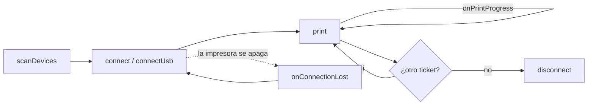
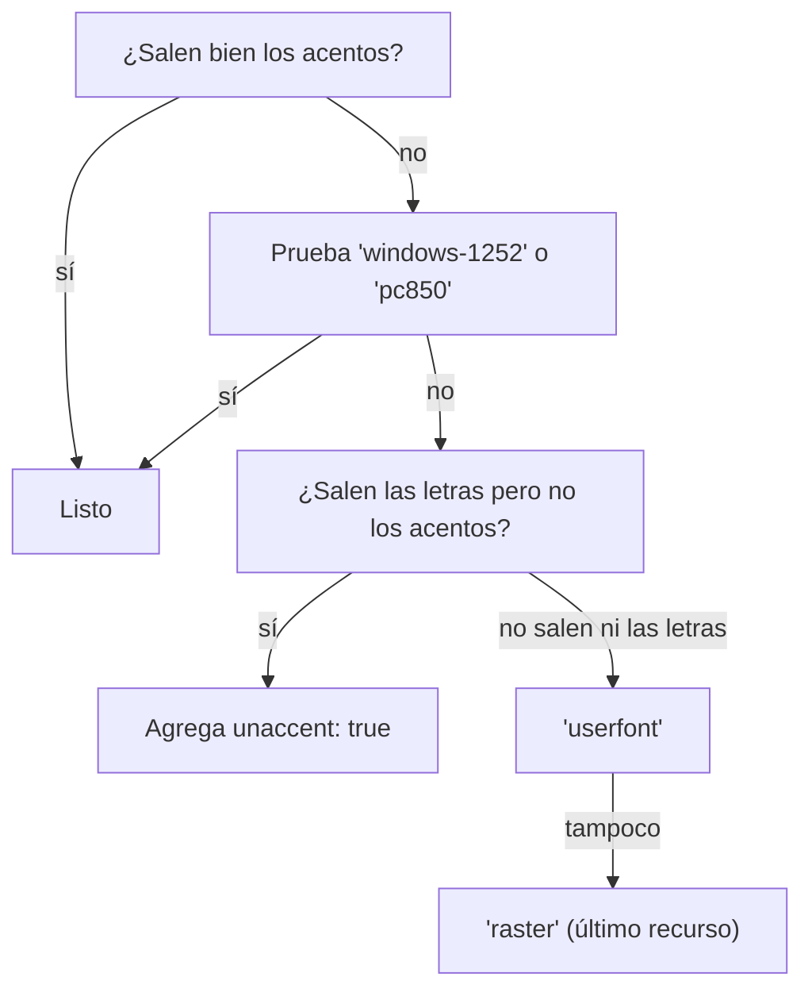

# 🖨️ react-native-ultimate-thermal-printer


Módulo nativo de Expo para imprimir tickets en **impresoras térmicas ESC/POS** desde React Native, por **Bluetooth** o **USB**.
Le pasas una lista de bloques (texto, tablas, QR, imágenes…) y la librería arma los comandos, los envía y te avisa del avance y de las desconexiones.

```ts
await ThermalPrinter.print([
  { type: 'text', content: 'MI TIENDA', style: { align: 'center', size: 'large', bold: true } },
  { type: 'two-columns', left: 'Total', right: '$50.00', style: { bold: true } },
  { type: 'qr', content: 'https://ejemplo.com', style: { align: 'center' } },
], { width: 58, encoding: 'windows-1252' });
```

---

## Contenido

- [Características](#-características)
- [Instalación y configuración](#-instalación-y-configuración)
- [Inicio rápido](#-inicio-rápido)
- [Guía de uso](#-guía-de-uso)
  - [Escanear](#1-escanear) · [Conectar](#2-conectar) · [Imprimir](#3-imprimir) · [Desconectar](#4-desconectar)
- [Bloques que puedes imprimir](#-bloques-que-puedes-imprimir)
- [Acentos y encodings: ¿cuál uso?](#-acentos-y-encodings-cuál-uso)
- [Progreso y conexión perdida](#-progreso-y-conexión-perdida)
- [Recetas para React](#-recetas-para-react)
- [Referencia de la API](#-referencia-de-la-api)
- [Errores](#-errores)
- [Cómo funciona por dentro](#-cómo-funciona-por-dentro)
- [Diagnóstico](#-diagnóstico)

---

## ✨ Características

| | Android | iOS |
|---|:---:|:---:|
| Bluetooth | ✅ Clásico (SPP) | ✅ BLE |
| USB | ✅ cualquier impresora con interfaz de impresora | — |
| Texto, tablas, dos columnas, divisores, avance de papel | ✅ | ✅ |
| Códigos QR | ✅ | ✅ |
| Imágenes (base64 o URL) | ✅ | ✅ |
| Barra de progreso | ✅ USB real · Bluetooth estimado | ✅ real (confirmaciones BLE) |
| Aviso de conexión perdida | ✅ | ✅ |
| Modos `userfont` y `raster` para impresoras sin fuente | ✅ | ✅ |
| `connectUsb()` e `isConnected()` | ✅ | ❌ no existen todavía |

- **Sin SDK de terceros:** desde la 1.7.0 la conexión es código propio; ya no hace falta el `.jar` de XPrinter.
- **Mismo payload en las dos plataformas:** el mismo arreglo de bloques produce el mismo ticket.
- **Errores con código estable** (`PRINT_FAILED`, `NOT_CONNECTED`…) para que los traduzcas en tu app.

---

## 📦 Instalación y configuración

> [!IMPORTANT]
> Es un módulo nativo: necesita un **[development build](https://docs.expo.dev/develop/development-builds/introduction/)** (`npx expo run:android` / `run:ios` o EAS Build). **No funciona en Expo Go.**

### 1. Instala desde GitHub

```bash
npm install git+https://github.com/ronix1020/expo-thermal-printer.git
```

> [!TIP]
> En producción fija un commit para que una actualización no te tome por sorpresa:
> ```json
> "@ronix1020/react-native-ultimate-thermal-printer": "github:ronix1020/expo-thermal-printer#<commit>"
> ```

### 2. Android: permisos

La librería ya declara en su manifest los permisos de Bluetooth, ubicación y USB, y Android los une a tu app. Lo que **sí te toca** es pedirlos en tiempo de ejecución antes de escanear o conectar:

```ts
import { PermissionsAndroid, Platform } from 'react-native';

export async function pedirPermisosBluetooth() {
  if (Platform.OS !== 'android') return true;

  const permisos = Platform.Version >= 31
    ? [PermissionsAndroid.PERMISSIONS.BLUETOOTH_SCAN, PermissionsAndroid.PERMISSIONS.BLUETOOTH_CONNECT]
    : [PermissionsAndroid.PERMISSIONS.ACCESS_FINE_LOCATION]; // Android ≤ 11 pide ubicación para escanear

  const resultado = await PermissionsAndroid.requestMultiple(permisos);
  return Object.values(resultado).every(r => r === PermissionsAndroid.RESULTS.GRANTED);
}
```

Para USB no hay que pedir nada antes: `connectUsb()` muestra el diálogo del sistema la primera vez.

### 3. iOS: texto del permiso de Bluetooth

Agrega el mensaje que verá el usuario en `app.json`:

```json
{
  "expo": {
    "ios": {
      "infoPlist": {
        "NSBluetoothAlwaysUsageDescription": "Usamos Bluetooth para conectar con tu impresora de tickets."
      }
    }
  }
}
```

---

## 🚀 Inicio rápido

```ts
import * as ThermalPrinter from '@ronix1020/react-native-ultimate-thermal-printer';

async function imprimirPrueba() {
  // 1. Busca impresoras (Android: vinculadas · iOS: escanea BLE ~5 s)
  const dispositivos = await ThermalPrinter.scanDevices('paired');
  const impresora = dispositivos.find(d => d.name.includes('Printer')) ?? dispositivos[0];

  // 2. Conecta (en Android es la MAC; en iOS, el identificador que devolvió el escaneo)
  await ThermalPrinter.connect(impresora.macAddress);

  // 3. Imprime
  await ThermalPrinter.print([
    { type: 'text', content: '¡Hola, impresora!', style: { align: 'center', bold: true } },
    { type: 'divider' },
    { type: 'feed', lines: 3 },
  ], { width: 58, encoding: 'windows-1252' });

  // 4. Desconecta (o mantén la conexión abierta para el siguiente ticket)
  await ThermalPrinter.disconnect();
}
```

---

## 🧭 Guía de uso



### 1. Escanear

```ts
const vinculadas = await ThermalPrinter.scanDevices('paired'); // rápido
const cercanas   = await ThermalPrinter.scanDevices('all');    // vinculadas + descubrimiento
// → [{ name: 'BlueTooth Printer', macAddress: '00:11:22:33:44:55' }, ...]
```

| | Android | iOS |
|---|---|---|
| `'paired'` | Dispositivos ya vinculados en Ajustes. | Igual que `'all'`. |
| `'all'` | Vinculados + los que encuentre el descubrimiento Bluetooth. Sin permiso de escaneo devuelve solo los vinculados. | Escanea BLE durante **5 s** y devuelve los que tienen nombre. |
| `macAddress` | La MAC real. | Un **UUID** que iOS asigna (iOS no expone la MAC). |

> [!NOTE]
> En iOS, `connect()` solo acepta dispositivos que aparecieron en un `scanDevices()` **de la sesión actual** de la app. Si guardas el UUID para reconectar luego, vuelve a escanear antes de conectar.

### 2. Conectar

```ts
// Bluetooth (Android: MAC · iOS: UUID del escaneo)
await ThermalPrinter.connect('00:11:22:33:44:55');

// USB (solo Android): toma la primera impresora conectada y pide permiso si hace falta
const nombre = await ThermalPrinter.connectUsb();
```

Puedes dejar la conexión abierta entre tickets; no hace falta conectar cada vez. En Android, llamar a `connect()` con otra impresora cierra la conexión anterior; en iOS llama a `disconnect()` antes de cambiar de impresora.

### 3. Imprimir

`print(bloques, opciones)` arma el ticket y lo envía. La promesa resuelve cuando termina el envío (en Android/Bluetooth, cuando termina el tiempo estimado; ver [Cómo funciona por dentro](#-cómo-funciona-por-dentro)).

```ts
await ThermalPrinter.print([
  { type: 'text', content: 'MI TIENDA', style: { align: 'center', size: 'xlarge', bold: true } },
  { type: 'text', content: 'Sucursal Centro\nTel. 2222-0000', style: { align: 'center' } },
  { type: 'divider', charToUse: '=' },
  {
    type: 'table',
    tableHeader: ['Producto', 'Cant', 'Total'],
    columnWidths: [60, 15, 25],              // porcentajes
    columnAlignment: ['left', 'center', 'right'],
    content: [
      ['Café americano', '2', '$5.00'],
      ['Pan dulce', '3', '$2.25'],
    ],
  },
  { type: 'divider' },
  { type: 'two-columns', left: 'TOTAL', right: '$7.25', style: { bold: true, size: 'large' } },
  { type: 'qr', content: 'https://ejemplo.com/factura/123', style: { align: 'center', size: 6 } },
  { type: 'text', content: '¡Gracias por su compra!', style: { align: 'center' } },
  { type: 'feed', lines: 3 },
], {
  width: 80,                 // 58 u 80 mm
  encoding: 'windows-1252',  // ver la guía de encodings
});
```

### 4. Desconectar

```ts
await ThermalPrinter.disconnect(); // siempre resuelve, aunque no hubiera conexión
```

---

## 🧱 Bloques que puedes imprimir

| `type` | Campos | Para qué |
|---|---|---|
| `text` | `content` | Texto libre; usa `\n` para varias líneas. |
| `two-columns` | `content: [izq, der]` o `left` + `right` | Una línea con un texto a cada lado (p. ej. `Total ........ $5`). |
| `table` | `content`, `columnWidths`, `tableHeader?`, `columnAlignment?` | Filas en columnas; los textos largos se parten en varias líneas. |
| `divider` | `charToUse` (o `char` / `content`), `marginVertical?` | Una línea completa con un carácter (`-` por defecto). |
| `qr` | `content`, `style.size` (1–16, por defecto 6) | Código QR nativo de la impresora. |
| `image` | `content` (base64 o URL `http(s)`), `style.width` / `style.height` | Logos, firmas, etc. |
| `feed` | `lines` (por defecto 1) | Líneas en blanco, útil antes del corte. |

### Estilos (`style`)

| Propiedad | Valores | Notas |
|---|---|---|
| `align` | `'left'` · `'center'` · `'right'` | |
| `bold` | `true` · `false` | |
| `size` | `'small'` · `'normal'` · `'large'` · `'xlarge'` o un número | `'large'` = doble alto (cabe bien en 58 mm), `'xlarge'` = doble alto y ancho. Un número es el byte `GS ! n` (p. ej. `0x11`). En `qr` es el tamaño del módulo. |
| `font` | `'primary'` · `'secondary'` | Fuente A (12×24) o B (más pequeña, más columnas). |
| `width` / `height` | píxeles | Solo `image`. `width` nunca pasa del ancho del cabezal. En Android, si das solo uno, el otro se calcula para mantener la proporción; iOS usa solo `width`. |

### Tablas: cómo se leen los anchos

`columnWidths` se interpreta solo, según cuánto sumen los números:

| Si la suma es… | Se toma como… | Ejemplo en 58 mm (32 caracteres) |
|---|---|---|
| ≤ caracteres del papel (32 en 58 mm, 48 en 80 mm) | **caracteres** exactos por columna | `[14, 3, 7, 8]` |
| mayor | **porcentajes** del ancho | `[60, 15, 25]` |

### Imágenes

```ts
{ type: 'image', content: logoBase64, style: { align: 'center', width: 300 } }
{ type: 'image', content: 'https://ejemplo.com/logo.png', style: { align: 'center' } }
```

- El base64 va **sin** el prefijo `data:image/png;base64,`.
- Si no das `width`, la imagen se reduce al ancho del papel (384 px en 58 mm, 576 px en 80 mm) cuando es más grande.
- Se imprime en blanco y negro; los logos de alto contraste salen mejor.

---

## 🔤 Acentos y encodings: ¿cuál uso?

Cada impresora trae sus propias tablas de caracteres. Si los acentos salen como símbolos raros, el encoding no coincide con el de la impresora.



| `encoding` | Úsalo cuando… | Costo |
|---|---|---|
| `'utf-8'` *(por defecto)* | la impresora entiende UTF-8 (pocas lo hacen). | — |
| `'windows-1252'` / `'iso-8859-1'` | necesitas acentos en español; funciona en la mayoría. | — |
| `'pc850'` | la impresora usa la página de códigos PC850. | — |
| `'gbk'` · `'cp1258'` · `'ascii'` | chino, vietnamita o solo ASCII. | — |
| `'userfont'` | la impresora **no imprime letras**: su fuente interna viene vacía (caso SAT AF330). La librería le descarga una fuente propia en cada ticket. | ~3.5 KB extra por ticket |
| `'raster'` | nada de lo anterior funciona. Todo el texto se dibuja como imagen. | ~100 KB por ticket, mucho más lento |

Alias aceptados: `utf8` → `utf-8`; `iso8859_1`, `iso88591`, `latin1` → `iso-8859-1`; `win1252` → `windows-1252`.

> [!TIP]
> `unaccent: true` quita los acentos en JavaScript antes de enviar (`á` → `a`, `ñ` → `n`). Es la salida más rápida si tu impresora no tiene una tabla con acentos.

<details>
<summary><b>Detalles de <code>userfont</code> y <code>raster</code></b></summary>

**`userfont`**
- Descarga una fuente monoespaciada de 12×24 puntos con `ESC &` y la activa con `ESC % 1`.
- Fija el área de impresión al ancho completo del papel (576 puntos en 80 mm, 384 en 58 mm).
- La impresora solo acepta caracteres ASCII como fuente propia. Por eso cada carácter con acento del ticket (`á`, `Ñ`, `°`…) se dibuja en un carácter ASCII que ese ticket no usa. Si se acaban, se imprime sin acento.
- Siempre usa la fuente A.

**`raster`**
- Dibuja el texto, las tablas, los divisores y las dos columnas como imagen, en la misma cuadrícula de caracteres que el modo texto (48 columnas en 80 mm, 32 en 58 mm), así que el acomodo no cambia.
- Respeta alineación, negrita y tamaño. QR e imágenes se envían como siempre.
- Por BLE en iOS es especialmente lento.

</details>

### Otras opciones de `print`

| Opción | Por defecto | Qué hace |
|---|---|---|
| `width` | `58` | Ancho del papel en mm (`58` u `80`). Define cuántos caracteres caben por línea. |
| `encoding` | `'utf-8'` | Ver la tabla de arriba. |
| `lineSpacing` | `30` | Espacio entre líneas, en puntos. |
| `feedLines` | `0` | Líneas en blanco al final del ticket. |
| `unaccent` | `false` | Quita acentos antes de enviar. |

---

## 📶 Progreso y conexión perdida

### Barra de progreso

```ts
const sub = ThermalPrinter.addPrintProgressListener(({ sent, total }) => {
  setProgreso(sent / total); // 0 → 1
});
await ThermalPrinter.print(bloques, opciones);
sub.remove();
```

| Plataforma | De dónde sale el avance |
|---|---|
| iOS | Real: bytes que la impresora confirmó por BLE. |
| Android · USB | Real: bytes transferidos. |
| Android · Bluetooth | **Estimado** a ~12 KB/s. Android no informa cuánto recibió la impresora. |

### Conexión perdida

Si la impresora se apaga o queda fuera de alcance, la librería emite `onConnectionLost`. No se dispara cuando tú llamas a `disconnect()`.

```ts
ThermalPrinter.addConnectionLostListener(({ msSinceLastPrint }) => {
  // 0     → había un print() en curso; ese print() ya falló con PRINT_FAILED
  // null  → no se imprimió nada en esta conexión
  // n > 0 → ms desde que terminó el último print()
  if (msSinceLastPrint !== null && msSinceLastPrint > 0 && msSinceLastPrint <= 30_000) {
    Alert.alert('Se perdió la conexión con la impresora', 'El último ticket podría haber salido incompleto.');
  }
  marcarImpresoraDesconectada();
});
```

> [!WARNING]
> En **Android por Bluetooth**, el sistema tarda **5 a 20 s** en darse cuenta de que la impresora se apagó. Si la apagan a mitad de un ticket, casi siempre `print()` ya terminó "con éxito" cuando llega el aviso. Por eso este evento existe: es la forma de avisarle al usuario que revise el papel. En iOS, en cambio, `print()` falla durante el envío y el evento llega con `msSinceLastPrint: 0`.

---

## ⚛️ Recetas para React

<details open>
<summary><b>Hook: imprimir con progreso y manejo de errores</b></summary>

```tsx
import { useState } from 'react';
import * as ThermalPrinter from '@ronix1020/react-native-ultimate-thermal-printer';
import type { PrinterItem, PrintOptions } from '@ronix1020/react-native-ultimate-thermal-printer';

export function useImpresion() {
  const [progreso, setProgreso] = useState<number | null>(null);
  const [error, setError] = useState<string | null>(null);

  async function imprimir(bloques: PrinterItem[], opciones: PrintOptions) {
    setError(null);
    setProgreso(0);
    const sub = ThermalPrinter.addPrintProgressListener(({ sent, total }) => setProgreso(sent / total));
    try {
      await ThermalPrinter.print(bloques, opciones);
    } catch (e: any) {
      setError(
        e.code === 'NOT_CONNECTED' || e.code === 'SERVICE_NOT_BOUND' ? 'Conecta una impresora primero.' :
        e.code === 'PRINT_FAILED'  ? 'Se perdió la conexión mientras imprimía.' :
        e.message
      );
    } finally {
      sub.remove();
      setProgreso(null);
    }
  }

  return { imprimir, progreso, error };
}
```

</details>

<details>
<summary><b>Reconectar automáticamente antes de imprimir</b></summary>

```ts
let conectado = false;
ThermalPrinter.addConnectionLostListener(() => { conectado = false; });

export async function imprimirConReconexion(mac: string, bloques: PrinterItem[], opciones: PrintOptions) {
  if (!conectado) {
    await ThermalPrinter.connect(mac); // en iOS, escanea antes: connect() solo acepta dispositivos del escaneo
    conectado = true;
  }
  try {
    await ThermalPrinter.print(bloques, opciones);
  } catch (e: any) {
    if (['PRINT_FAILED', 'NOT_CONNECTED', 'SERVICE_NOT_BOUND'].includes(e.code)) conectado = false;
    throw e;
  }
}
```

</details>

---

## 📚 Referencia de la API

| Función | Devuelve | Android | iOS | Descripción |
|---|---|:---:|:---:|---|
| `scanDevices(type?)` | `Promise<Device[]>` | ✅ | ✅ | `'paired'` (por defecto) o `'all'`. |
| `connect(id)` | `Promise<void>` | ✅ | ✅ | MAC en Android, UUID del escaneo en iOS. |
| `connectUsb()` | `Promise<string>` | ✅ | ❌ | Conecta la primera impresora USB; devuelve su nombre. |
| `disconnect()` | `Promise<void>` | ✅ | ✅ | Siempre resuelve. |
| `isConnected()` | `Promise<boolean>` | ✅ | ❌ | Estado local de la conexión. |
| `print(items, options?)` | `Promise<void>` | ✅ | ✅ | Ver [Imprimir](#3-imprimir). |
| `addPrintProgressListener(fn)` | `{ remove() }` | ✅ | ✅ | `fn({ sent, total })` en bytes. |
| `addConnectionLostListener(fn)` | `{ remove() }` | ✅ | ✅ | `fn({ msSinceLastPrint })`. |

<details>
<summary><b>Tipos exportados</b></summary>

```ts
type Device = { name: string; macAddress: string };

type PrinterItem = TextItem | TwoColumnsItem | TableItem | DividerItem | QrItem | ImageItem | FeedItem;

interface PrinterItemStyle {
  align?: 'left' | 'center' | 'right';
  bold?: boolean;
  size?: number | 'small' | 'normal' | 'large' | 'xlarge';
  font?: 'primary' | 'secondary';
  width?: number;  // solo image
  height?: number; // solo image
}

interface PrintOptions {
  width?: number;
  encoding?: PrinterEncoding;
  lineSpacing?: number;
  feedLines?: number;
  unaccent?: boolean;
}

interface PrintProgress { sent: number; total: number }
interface ConnectionLost { msSinceLastPrint: number | null }
```

</details>

---

## 🚨 Errores

Todas las promesas rechazan con un `code` estable y un `message` corto en inglés que puedes traducir. Los códigos marcados con plataforma solo aparecen en esa plataforma:

```ts
try {
  await ThermalPrinter.print(bloques);
} catch (e: any) {
  console.log(e.code, e.message); // p. ej. 'PRINT_FAILED', 'Printer disconnected during print'
}
```

| `code` | Cuándo pasa | Qué hacer |
|---|---|---|
| `BLUETOOTH_NOT_READY` | Bluetooth apagado, sin permiso o todavía iniciando. | Pide al usuario que lo encienda o revisa los permisos. |
| `DEVICE_NOT_FOUND` | No apareció la impresora (en iOS: no estaba en el último escaneo) o no hay impresora USB. | Escanea de nuevo o revisa el cable. |
| `CONNECTION_FAILED` | La impresora no aceptó la conexión. | ¿Está encendida y cerca? ¿Conectada a otro teléfono? |
| `NOT_CONNECTED` | (Android) Llamaste a `print()` sin conectar. | Llama a `connect()` / `connectUsb()` primero. |
| `PRINT_FAILED` | Se cortó la conexión mientras se enviaba el ticket. | Reconecta y reimprime; avisa que el ticket pudo salir incompleto. |
| `SERVICE_NOT_BOUND` | (iOS) Llamaste a `print()` sin una conexión lista; equivale a `NOT_CONNECTED`. | Conecta de nuevo. |
| `ALREADY_PRINTING` | (iOS) Llamaste a `print()` mientras otro seguía enviándose. | Espera a que termine el anterior. |
| `ALREADY_SCANNING` | (Android) Llamaste a `scanDevices('all')` dos veces seguidas. | Espera a que termine el primer escaneo. |
| `PERMISSION_DENIED` | (Android) El usuario rechazó el permiso USB. | Vuelve a llamar a `connectUsb()`. |

---

## 🔧 Cómo funciona por dentro

<details>
<summary><b>¿Por qué en Android/Bluetooth el progreso es estimado?</b></summary>

Android acepta el ticket entero en un buffer del sistema y responde en ~1 ms, aunque sean 100 KB. No hay ninguna API que diga cuánto de eso ya llegó a la impresora. Por eso `print()` espera `tamaño ÷ 12 KB/s` antes de resolver: así, si tu app desconecta justo después, no corta el ticket. El valor viene de medir una SAT AF330 (~16 KB/s) con margen para impresoras más lentas.

Pedirle el estado a la impresora (`DLE EOT`) tampoco ayuda: la consulta queda en la misma fila detrás del ticket, y muchas impresoras (como la AF330) ni siquiera responden.

</details>

<details>
<summary><b>¿Por qué el aviso de conexión perdida llega tarde en Android?</b></summary>

La librería lee el socket todo el tiempo y se entera de la caída en cuanto Android la reporta. Pero Android solo la reporta cuando vence el tiempo de espera del enlace (5–20 s según el teléfono). En iOS el envío por BLE falla mientras se transmite, así que `print()` rechaza.

</details>

<details>
<summary><b>Transporte</b></summary>

- **Android · Bluetooth:** `BluetoothSocket` SPP (`00001101-0000-1000-8000-00805F9B34FB`) en un hilo propio, para no bloquear a los demás módulos de Expo.
- **Android · USB:** `UsbManager` + `bulkTransfer` al endpoint de salida, en bloques de 16 KB. Acepta cualquier marca que se presente como impresora.
- **iOS · BLE:** CoreBluetooth; los datos se parten según la MTU y se envían respetando el control de flujo (con confirmación cuando la impresora lo soporta).

</details>

---

## 🩺 Diagnóstico

En Android puedes ver los bytes exactos de cada ticket (tamaño, CRC32, ancho, encoding, transporte y un volcado hex) sin recompilar:

```bash
adb shell setprop log.tag.ThermalPrinter VERBOSE   # encender
adb logcat -s ThermalPrinter                       # leer
adb shell setprop log.tag.ThermalPrinter ""        # apagar
```

Viene apagado por defecto para que los datos del ticket no queden en el log.

---

## 📄 Licencia

MIT · Historial de cambios en [CHANGELOG.md](./CHANGELOG.md)
